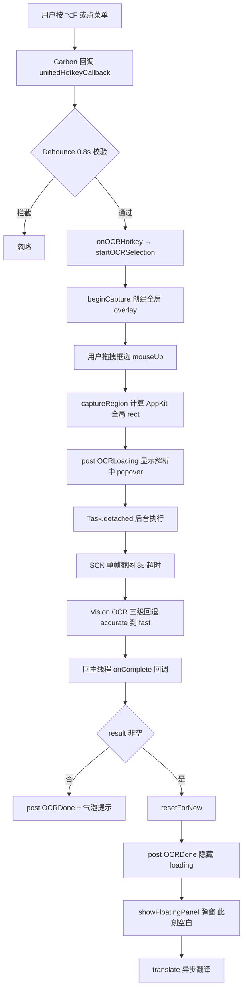

# OCR 划词取词性能与反馈优化方案

> 版本: v1.0 | 日期: 2026-08-17 | 模式: 架构设计（待 code 模式实现）
> 目标: 定位并消除「窗口弹出慢 / 无反馈」瓶颈，OCR 分析期间菜单栏立即显示「正在解析中…」，
> 解析完成后才弹结果窗口，杜绝空白/半渲染帧，异步解耦不阻塞 UI，防止重复触发/状态错乱/回调丢失。

---

## 1. 现状主链路梳理

### 1.1 触发入口（两条）
- **OCR 快捷键（默认 ⌥F，Carbon hotkey id=2）**：`unifiedHotkeyCallback` → `DebounceController`（0.8s 防抖）→ `DispatchQueue.main.async { onOCRHotkey?() }` → `AppDelegate.startOCRSelection()`
- **菜单栏「OCR 翻译」**：`menuOCR()` → `DispatchQueue.main.async { startOCRSelection() }`

### 1.2 框选阶段
`startOCRSelection()` → `OCRSelectionOverlay.shared.beginCapture(completion:)`
- `guard window == nil`（防重复 overlay）
- `DisplayGeometry.screen(containing: mouse)` 选定鼠标所在屏（多屏正确）
- 创建全屏透明 overlay（`level = .screenSaver`），用户拖拽框选
- `OverlayView.mouseUp` → `onSelect(rect)` 回调

### 1.3 OCR 处理阶段
`OCRSelectionOverlay.captureRegion(viewRect)`
1. 校验区域尺寸（< 20×10 视为取消）
2. `dismiss()` 移除 overlay（并异步 purge）
3. **post `.omniTransOCRLoading`**（此刻才开始显示「OCR识别中…」）
4. `Task.detached`（后台，不阻塞主线程）：
   - `ScreenCaptureService.capture`：`SCShareableContent.current`（主 actor）→ `SCStream` 单帧（3s 超时）→ `CVPixelBuffer`
   - `performOCR`：Vision 三级串行回退（`.accurate`+all → `.fast`+all → `.fast`+en-only）
   - 回主线程：`result == nil` → post `.omniTransOCRNoTextFound`；调用 `onComplete(result)`

### 1.4 弹窗 + 翻译阶段（AppDelegate.startOCRSelection 的 completion）
```swift
guard let self, let result else { post OCRDone; return }
let s = AppState.shared
s.resetForNew(text: result.text)     // ① 重置（取消旧 activeStreamTask）
post OCRDone                          // ② 隐藏 loading
self.showFloatingPanel()              // ③ 弹窗（此刻 translatedText 为空！）
s.translate()                         // ④ 才开始翻译（同步设 isTranslating=true）
```

### 1.5 主链路 Mermaid



---

## 2. 关键瓶颈定位

### 瓶颈 1（核心）— 弹窗存在空白/半渲染帧
- 位置: [`App.swift`](../../Sources/OmniTrans/App.swift) `startOCRSelection()` completion（第 577-581 行）
- 现象: `showFloatingPanel()` 在 `s.translate()` **之前**。`makeKeyAndOrderFront` 渲染时 `isTranslating == false`、`translatedText == ""` → `displayMode == .empty`（见 [`FloatingPanelContent.swift`](../../Sources/OmniTrans/Views/FloatingPanelContent.swift) 第 88-95 行）→ 先闪一帧空白，再跳到「正在翻译…」。
- 结论: 违反「严禁提前弹出空白/半渲染窗口」。SwiftUI 状态在下一 runloop 才刷新，视觉上明确可见。

### 瓶颈 2（核心）— 「正在解析中…」状态反馈不可靠
- 位置: [`App.swift`](../../Sources/OmniTrans/App.swift) `showOCRLoadingIndicator()`（第 539-561 行）
- 现象: `NSPopover.behavior = .transient`。**transient 特性：点击 popover 外部任意位置或 app 失焦即自动关闭**。OCR 分析期间（截图 + Vision 可能 1-3s）用户稍动鼠标即丢失反馈，回到「无感知等待」。
- 且 loading 在 `captureRegion`（松开鼠标）才 post，**框选拖拽过程中无任何文字反馈**，仅灰色蒙层。

### 瓶颈 3 — 连续触发导致结果串台 / 回调丢失
- 位置: [`OCRSelectionOverlay.swift`](../../Sources/OmniTrans/Services/OCRSelectionOverlay.swift) `beginCapture` / `captureRegion`
- 现象: `onComplete` 是单一可变属性。若 OCR-A 处理中（overlay 已 dismiss、`window == nil`）再次触发，新 `beginCapture` 覆盖 `onComplete` 并创建 overlay-B。OCR-A 完成时 `self.onComplete?(resultA)` 实际执行 **B 的闭包** → 结果串台、重复弹窗、状态错乱。
- `guard window == nil` 只防「overlay 未消失」阶段，防不住「overlay 已消失但 OCR 未完成」阶段。

### 瓶颈 4 — 整体等待 = 截图 + 串行 Vision 回退
- 位置: [`CaptureService.swift`](../../Sources/OmniTrans/Services/CaptureService.swift)（SCStream 单帧 3s 超时）、[`OCRSelectionOverlay.swift`](../../Sources/OmniTrans/Services/OCRSelectionOverlay.swift) `performOCR`（accurate → fast+all → fast+en 串行）
- 说明: 探针已判定 `.ane/.cpu` 时 accurate 无超时（可能 1-3s）；失败再串行两次 fast。等待期间若反馈稳定（瓶颈 2 修复后），用户有明确感知，不属「无反馈卡顿」。
- 结论: 本任务以「反馈覆盖 + 弹窗时机」为主，OCR 耗时本身已由硬件探针优化，非首要改动。

### 瓶颈 5 — dismiss 触发两次 purge 与 Vision 抢 CPU（次要）
- 位置: [`OCRSelectionOverlay.swift`](../../Sources/OmniTrans/Services/OCRSelectionOverlay.swift) `dismiss()`（第 362-375 行）
- 现象: 每次 OCR 开始前 main.async + global.async 各触发一次 `purgeBackendCache()`，与 Vision 推理争抢 CPU/IO。异步不阻塞主线程，但属无效开销。
- 结论: 可把 purge 延后到 OCR 完成后（minor 优化）。

---

## 3. 优化方案

### 方案 A — 稳定状态机 + statusItem 标题反馈（解决瓶颈 2）
在 `AppDelegate` 引入 `OCRBusyState` 状态机，以 **statusItem 按钮标题/图标** 为主通道（不依赖 popover 焦点，点击/失焦不丢失）：

```swift
enum OCRBusyState { case idle, selecting, parsing }
```

| 状态 | 触发点 | 菜单栏表现 |
|------|--------|-----------|
| `.selecting` | `startOCRSelection()` 开头 | 图标旋转 + popover「拖选屏幕区域…」（`.applicationDefined`，不自动关闭） |
| `.parsing` | `captureRegion` 同步段（mouseUp） | **button.title = "解析中…"** + 图标旋转（稳定主通道） |
| `.idle` | OCR 完成/失败/取消 | 还原图标，清除 title，关闭 popover |

实现要点：
- 新增 `setOCRStatus(_:)` / `clearOCRStatus()` 替代 `showOCRLoadingIndicator()` / `hideOCRLoadingIndicator()`。
- popover 由 `.transient` 改为 `.applicationDefined`（需手动 close），杜绝点击丢失；同时保留 `ocrLoadingPopover` 引用。
- 既有 `OmniTransOCRLoading / OmniTransOCRDone` 通知保留（兼容），但由 `setOCRStatus` 统一驱动。

### 方案 B — 弹窗时序修正，杜绝空白帧（解决瓶颈 1）
调整 `startOCRSelection()` completion 顺序：**先 `s.translate()` 再 `showFloatingPanel()`**：

```swift
guard let self, let result else { post OCRDone; return }
let s = AppState.shared
s.resetForNew(text: result.text)
s.translate()                 // 同步：命中缓存 → 填充结果；未命中 → isTranslating = true
clearOCRStatus()              // 恢复状态栏
self.showFloatingPanel()      // 面板出现即显示「正在翻译…」动画或缓存结果，绝无空白帧
```

- `translate()` 的 cache-gate 路径**同步**填充 `translatedText` 并 `isTranslating = false`；doTranslate 路径**同步**置 `isTranslating = true`（见 [`AppState.swift`](../../Sources/OmniTrans/Models/AppState.swift) 第 250-265、268-273 行）。故 translate() 返回后状态已就绪，再弹窗最稳妥。

### 方案 C — captureGeneration 防串台（解决瓶颈 3）
在 `OCRSelectionOverlay` 增加单调递增代际号：

```swift
private var captureGeneration = 0   // @MainActor

func beginCapture(completion:) {
    guard window == nil else { return }
    captureGeneration += 1
    let gen = captureGeneration
    onComplete = completion
    ...
}
```
`captureRegion` 的 `Task.detached` 完成后回主线程时校验：
```swift
await MainActor.run {
    guard gen == self.captureGeneration else { return }  // 过期结果静默丢弃
    ... onComplete?(result); onComplete = nil
}
```
- 新流程接管后旧结果不再串给新闭包；旧 Task 无法取消但结果被丢弃，无副作用。
- 同时为 `performOCR` 的两次 fast 回退与 `onComplete` 提供「单一归属」保证。

### 方案 D — 反馈覆盖完整等待期 + 边界保护
- 框选阶段（`.selecting`）→ 解析阶段（`.parsing`）→ 完成/失败（`.idle`），状态连续，无空窗。
- OCR 极快（< 100ms）时 popover 动画未完成即关闭：可接受（用户几乎无感），且 icon/title 已即时切换再还原，无闪烁残留。
- 失败路径（capture nil / no text）→ 置 `.idle` + 既有气泡提示（`OmniTransOCRCaptureFailed` / `OmniTransOCRNoTextFound`）。

### 方案 E — 次要性能优化（可选）
- `dismiss()` 的两次 `purgeBackendCache()` 延后到 OCR 完成后执行（避免与 Vision 抢 CPU）。
- `performOCR` 的 `.fast` 两次回退保持串行（资源竞争考量），不改。

---

## 4. 涉及文件与核心函数改动

| 文件 | 函数 | 改动 |
|------|------|------|
| [`App.swift`](../../Sources/OmniTrans/App.swift) | `showOCRLoadingIndicator()` / `hideOCRLoadingIndicator()` | 重构为 `setOCRStatus(_:)` / `clearOCRStatus()`，popover 改 `.applicationDefined` |
| [`App.swift`](../../Sources/OmniTrans/App.swift) | `startOCRSelection()` | 开头 `.selecting`；completion 调整顺序（translate 先、show 后）+ 状态切换 |
| [`OCRSelectionOverlay.swift`](../../Sources/OmniTrans/Services/OCRSelectionOverlay.swift) | `beginCapture` / `captureRegion` | 新增 `captureGeneration`；完成回调 generation 校验；dismiss purge 延后 |
| [`AppState.swift`](../../Sources/OmniTrans/Models/AppState.swift) | `translate()` | 无需改动（语义已满足先 translate 后 show） |
| [`FloatingPanelContent.swift`](../../Sources/OmniTrans/Views/FloatingPanelContent.swift) | — | 无需改动（translatingView 已存在，见第 737-746 行） |

---

## 5. 线程 / 队列调度策略

```
Carbon 事件线程 ──> DebounceController 同步校验（<1µs）──> DispatchQueue.main.async 触发 UI
主线程 (MainActor) ──> startOCRSelection / setOCRStatus / resetForNew / showFloatingPanel / translate 状态设置
后台 Task.detached ──> SCK 截图 + Vision 推理（不阻塞主线程）
SCShareableContent.current ──> 主 actor 获取（Apple 要求），其余截图流程在后台
SCStream 采样队列 ──> DispatchQueue.global(qos: .userInitiated)
翻译网络 I/O ──> TranslationActor（actor 隔离），结果回 MainActor 流式刷新
```

- **关键不变式**：OCR 全流程（截图 + Vision）在 `Task.detached` 后台，主线程只做轻量状态切换与窗口编排，绝不阻塞。
- **状态更新与弹窗异步解耦**：状态栏更新走 NotificationCenter/状态机（main queue），弹窗在 OCR completion 后触发，二者通过「先 translate 后 show」保证视觉无空窗。
- **防重复触发**：`DebounceController`（0.8s）+ `guard window == nil` + `captureGeneration` 三层防护。

---

## 6. 异常处理机制

| 异常场景 | 处理 |
|---------|------|
| 屏幕录制权限缺失（SCK -3808） | post `OmniTransOCRCaptureFailed` → 气泡提示 + 置 `.idle` |
| SCStream 超时 / 捕获 nil | capture 返回 nil → post `OmniTransOCRCaptureFailed` + `.idle` |
| Vision 未识别到文字 | post `OmniTransOCRNoTextFound` → 气泡提示 + `.idle` |
| 区域过小 / Esc 取消 | `onComplete?(nil)` → `.idle`（不弹窗） |
| 新 OCR 覆盖旧 OCR | `captureGeneration` 校验，过期结果静默丢弃 |
| 翻译网络异常 | 既有 `errorView` + 状态灯（不属本任务改动） |
| loading 状态泄漏 | `startOCRSelection()` 每次重置状态机；应用终止清理 popover |

---

## 7. 测试验证计划

1. **单元测试（新增）**：
   - `OCRGenerationGuard`：模拟两次 beginCapture，验证旧 generation 回调被丢弃、新回调正常。
   - `OCRBusyState`：验证 `.idle → .selecting → .parsing → .idle` 状态转换幂等与复位。
2. **构建验证**：`swift build`（clean）0 error / 0 warning。
3. **回归**：既有 `DisplayGeometryTests` 12 例全绿。
4. **集成验证（人工）**：
   - 按 ⌥F 框选 → 菜单栏立即出现「解析中…」（框选结束即切状态，点击/失焦不消失）。
   - OCR 完成 → 面板直接以「正在翻译…」动画或缓存结果出现，无空白帧。
   - 快速连续触发 → 无重复弹窗、无结果串台、状态栏最终复位。

---

## 8. 结论

- **窗口弹出慢的根因**是「先弹窗后翻译」造成的空白帧 + 「transient popover 反馈易丢失」带来的无感知等待，而非主线程阻塞（OCR 已在后台）。
- 通过 **状态机稳定反馈（statusItem 标题 + applicationDefined popover）** 与 **先 translate 后 show 的时序修正**，即可让用户全程有反馈、且弹窗首帧即有效内容。
- **captureGeneration** 从根上消除连续触发的结果串台与回调丢失，保障稳定性。
